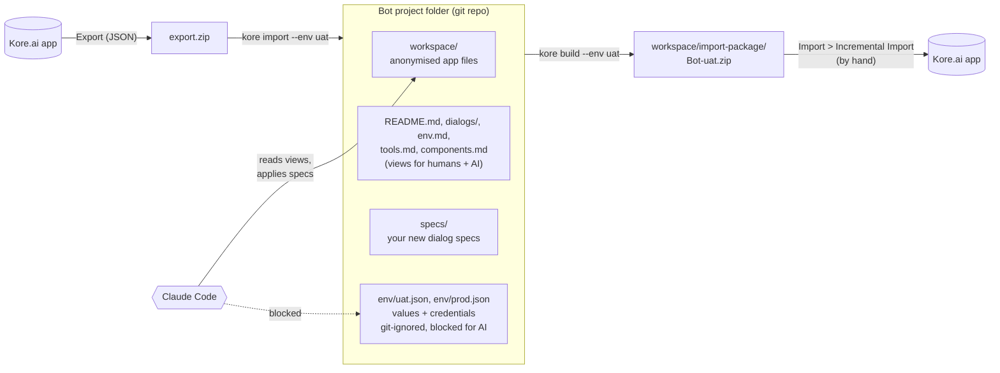
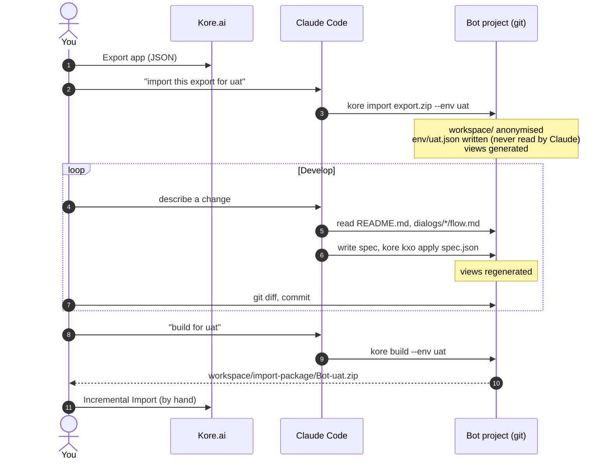
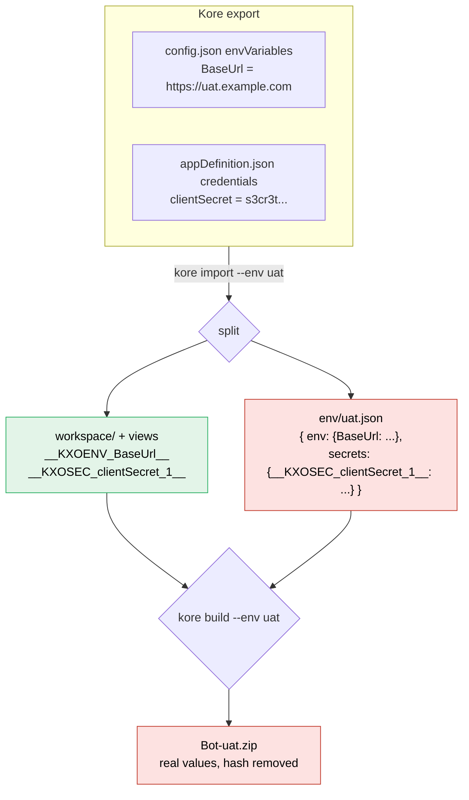
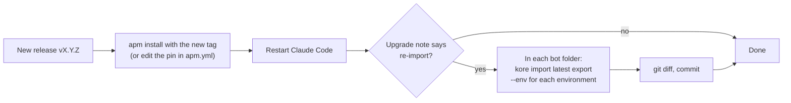

# kore-xo-dialogs

> A Claude Code skill for building **Kore.ai XO / AI for Service** bots as files: import an app export, let Claude
> edit dialogs through JSON specs, and build an import zip per environment. No clicking through the dialog builder,
> and **secret values never reach the LLM**.

| | |
|---|---|
| **What it is** | Claude Code skill (`SKILL.md`) + two Python CLIs: `kore` (project pipeline) and `kxo` (dialog editor) |
| **Requires** | Python 3.8+ as `python` (standard library only), git, Claude Code |
| **Distributed with** | [APM](https://microsoft.github.io/apm/) as `vovarova/kore-xo-dialogs`, or by copying the folder |
| **In scope** | import, develop, build the import zip |
| **Out of scope** | deploying to Kore and conversation testing (you import the zip by hand) |

---

## Contents

- [How it works](#how-it-works)
- [Install](#install)
- [Quick start](#quick-start)
- [The three stages](#the-three-stages)
- [Project layout](#project-layout)
- [Environments and secrets](#environments-and-secrets)
- [What Claude can build](#what-claude-can-build)
- [Command reference](#command-reference)
- [Upgrading](#upgrading)
- [For AI agents](#for-ai-agents)
- [Repository layout](#repository-layout)

---

## How it works



1. **Import** turns a Kore export into a git-friendly project. Env-variable values and credentials are moved out
   into `env/<name>.json` and replaced by placeholders everywhere else.
2. **Develop**: you describe changes, Claude edits dialogs through `kxo` specs; `git diff` shows what changed.
3. **Build** puts the values of one environment back in and writes a zip that Kore accepts.

---

## Install

Pick one. Both work the same way afterwards.

### With APM (recommended)

```bash
# per user: available in every project  -> ~/.claude/skills/kore-xo-dialogs
apm install -g --target claude vovarova/kore-xo-dialogs#v0.1.0

# per repo: committed with the bot repo   -> .claude/skills/kore-xo-dialogs
apm install --target claude vovarova/kore-xo-dialogs#v0.1.0
```

Per repo: commit `apm.yml` and `apm.lock.yaml`; teammates run `apm install` after cloning.
Restart Claude Code after installing so it loads the skill.

### By hand

| Mode | Where | `kore` is called as |
|---|---|---|
| Per user | copy this folder to `~/.claude/skills/kore-xo-dialogs/` | `python "$HOME/.claude/skills/kore-xo-dialogs/scripts/kore.py"` |
| Per repo | commit it as `<repo>/.claude/skills/kore-xo-dialogs/` | a relative path, e.g. `python ".claude/skills/kore-xo-dialogs/scripts/kore.py"` |

`kore import` writes the right command into the bot's `CLAUDE.md` as `KORE = ...`, so you and Claude can just use
`$KORE`. With a per-repo install, bot folders can be the repo root or subfolders such as `bots/<bot>/`.

---

## Quick start

```bash
# 1. Export the app in Kore: App Settings > App Management > Export (JSON)

# 2. Import it into a new project folder (per-user install shown; see KORE in the bot's CLAUDE.md)
python "$HOME/.claude/skills/kore-xo-dialogs/scripts/kore.py" import "$HOME/Downloads/My Bot.zip" --env uat --to my-bot
cd my-bot && git init && git add -A && git commit -m "Import My Bot (uat)"

# 3. Open Claude Code in my-bot/ and ask, e.g.:
#    "Add a dialog 'Reset Password' that asks for the email, calls the reset service and confirms."

# 4. Build the zip for UAT
python "$HOME/.claude/skills/kore-xo-dialogs/scripts/kore.py" build --env uat
#    -> workspace/import-package/My_Bot-uat.zip
#    Kore: App Settings > App Management > Import > Incremental Import
```

> In practice you rarely type these: ask Claude ("import this export for uat", "build for prod") and it runs `$KORE`.

---

## The three stages



### 1. Import

```bash
$KORE import "<export.zip or folder>" --env uat --to <new folder>   # new project
$KORE import "<export.zip or folder>" --env uat                     # refresh an existing project
$KORE import "<prod export.zip>" --env prod                         # add another environment
```

- One project folder holds **exactly one bot** (`kore.project.json`). Importing a different bot into it is refused.
- A refresh overwrites `workspace/` and the views; review with `git diff`.
- Values that come out empty in the export (Kore exports secured variables empty) keep the value already in
  `env/<name>.json`.

### 2. Develop

Claude follows the rules in the project's `CLAUDE.md`. All edits go through kxo specs:

```bash
$KORE kxo list                                   # dialogs
$KORE kxo show "<Dialog>"                        # the flow as text
$KORE kxo apply "dialogs/<Dialog>/spec.json"     # change an existing dialog
$KORE kxo apply specs/new-dialog.json            # create a dialog from a spec
$KORE kxo clone "<Dialog>" "<New Dialog>" --utterance "..."
$KORE kxo validate
git diff                                         # what changed (git is the baseline)
```

### 3. Build

```bash
$KORE build --env uat
```

- Validates the workspace, puts the `env/uat.json` values back, removes `encryptedHash` (Kore rejects edited
  exports that keep it) and stops if any placeholder is left.
- Writes `workspace/import-package/<Bot>-uat.zip` with the files at the zip root, like a Kore export.
- Warns about env variables that are empty for that environment.

Then in Kore: **App Settings > App Management > Import > Incremental Import**. Export a backup of the app first.

> Incremental import never deletes dialogs or nodes in Kore. If you removed something, delete it in the UI too.

---

## Project layout

What `kore import` creates in a bot folder:

```text
my-bot/
├── kore.project.json        # marker: bot name, appId, last import info
├── CLAUDE.md                # rules for Claude + KORE = <command>
├── README.md                # generated: overview of dialogs, nodes, tools
├── dialogs/<Dialog>/
│   ├── flow.md              # generated: readable flow of one dialog
│   └── spec.json            # generated: editable kxo spec of that dialog
├── env.md                   # generated: env keys and which envs have a value (never the values)
├── tools.md                 # generated: agent-node tools
├── components.md            # generated: nodes shared between dialogs
├── index.json               # generated: machine-readable index
├── specs/                   # your own specs (new dialogs, partial edits)
├── workspace/               # anonymised appDefinition.json, config.json, icon.png
│   └── import-package/      # built zips            (git-ignored, blocked for AI)
├── env/
│   ├── uat.json             # values + credentials  (git-ignored, blocked for AI)
│   └── prod.json
└── .claude/
    ├── settings.json        # deny rules + hook registration
    └── hooks/vault_guard.py # blocks tool calls that touch env/ or import-package/
```

Commit everything except `env/` and `workspace/import-package/` (already in `.gitignore`).
Never hand-edit `workspace/` or the generated files; they are rewritten after every apply, clone and import.

---

## Environments and secrets



- **One file per environment**: `env/<name>.json` = `{"env": {KEY: value}, "secrets": {TOKEN: value}}`.
  Add an environment by importing its export with `--env <name>`, or copy an env file and edit the values.
- **Placeholders**: `__KXOENV_<KEY>__` for env-variable values, `__KXOSEC_<field>_<n>__` for credentials.
  New nodes reference env variables the Kore way: `{{env.KEY}}` in messages/URLs/headers, `env.KEY` in scripts.
- **Protection for AI**, so values are not sent to the model:

  | Layer | What it does |
  |---|---|
  | `.gitignore` | `env/` and `workspace/import-package/` are never committed |
  | `.ignore` | ripgrep-based search (Claude's Grep/Glob) skips them |
  | `permissions.deny` | Claude Code refuses `Read`/`Edit`/`Write` on `**/env/**` and `**/workspace/import-package/**` |
  | `vault_guard.py` hook | blocks tool calls and shell commands that name those folders or search the project recursively |
  | `CLAUDE.md` rules | Claude never reads, lists or prints them; it asks you to edit values |

  When the bot is inside a larger git repo, the deny rules and hook are written to the repo root too, so the
  protection holds wherever Claude Code is started.
- **Not detected**: secrets hard-coded in service headers, bodies, URLs or scripts. Put those in env variables.

---

## What Claude can build

| Node type (spec `type`) | Kore type | Create and edit with named fields |
|---|---|---|
| `message` | message | `text` / `prompts` |
| `entity` | entity | `entityType`, `text`, `errorPrompts` |
| `confirmation` | dialogAct | `text`, `synonyms`, `yes` / `no` branches |
| `script` | script | `script` (JavaScript) |
| `service` | service | `method`, `url`, `headers`, `body`, `timeout` |
| `prompt` | generativeai | `prompt`; model copied from an existing prompt node |
| `agent` | aiassist | `systemContext`, `rules`, `exitScenarios`, `entities`, `tools`; model copied |
| `logic`, `form`, `searchai`, `agentTransfer`, `dynamicIntent`, `webhook` | same | transitions only; settings through `raw` (Kore JSON) |

For the types in the last row, the safest way to add one is to copy an existing node of the same type
(`clone` a dialog, or `use` / `fork` a node). Full spec syntax: [`reference/spec-format.md`](reference/spec-format.md).

Claude also learns from the bot itself: existing dialogs (`dialogs/*/flow.md`), shared nodes (`components.md`)
and agent tools (`tools.md`) are the patterns it follows and reuses.

---

## Command reference

### `kore` (project pipeline)

| Command | Purpose |
|---|---|
| `kore import <export> --env <name> [--to <folder>]` | create or refresh the project, write `env/<name>.json` |
| `kore kxo <command> [args]` | run a kxo command on the workspace; views regenerate after `apply`, `clone`, `delete-dialog` |
| `kore build --env <name>` | write `workspace/import-package/<Bot>-<name>.zip` |
| `--root <folder>` | project folder (default: nearest folder with `kore.project.json`) |

Inside a project, `kore kxo` refuses `init`, `build`, `diff`, `deploy`: use `kore import`, `kore build` and `git diff`.

### `kxo` (dialog editor, also usable without a project)

| Command | Purpose |
|---|---|
| `list [--all]` | dialogs (`--all` includes hidden/system ones) |
| `show <dialog>` | flow as text |
| `get <dialog> [-o file] [--raw]` | dialog → editable spec (`--raw`: full component JSON) |
| `apply <spec> [--dry-run] [--allow-shared]` | create or update dialogs; idempotent |
| `clone <dialog> <new> [--utterance ...] [--suffix ...]` | copy a dialog with new node names |
| `delete-dialog <dialog>` | remove a dialog from the file |
| `validate` | integrity check |

Without a project (plain export folder):

```bash
python scripts/kxo.py init "<export folder or zip>" ws
python scripts/kxo.py apply -w ws examples/new-dialog.json
python scripts/kxo.py build -w ws --strip-hash
```

Check kxo against a new app or Kore version first: `python scripts/selftest.py "<export>"`.

---

## Upgrading



```bash
apm outdated              # bot repo   (apm outdated -g for the per-user install)
# per repo: change #vOLD to #vNEW in apm.yml, then
apm install && git add apm.yml apm.lock.yaml
# per user:
apm install -g --target claude vovarova/kore-xo-dialogs#vNEW
```

Files that `kore import` wrote into a bot folder (`CLAUDE.md`, hook, settings, views) keep the old version until
you re-import that bot. Re-importing is safe: `env/` values are kept and `git diff` shows every change.

### Upgrade notes

| Version | After upgrading |
|---|---|
| v0.1.0 | first release |

### Releasing (maintainers)

1. Commit the changes, bump `version` in `apm.yml`, add a row to **Upgrade notes**.
2. `git tag vX.Y.Z && git push origin main vX.Y.Z`

---

## For AI agents

If you are an AI agent working with this skill:

1. **Read [`SKILL.md`](SKILL.md) first**; inside a bot project, the project's `CLAUDE.md` is authoritative.
2. **Never read, search, list, copy or print** `env/` or `workspace/import-package/`, and never run recursive
   shell searches over a bot project. Use Grep/Glob or name `dialogs/`, `specs/`, `workspace/` explicitly.
3. **Never write values or invent placeholders**. Keep existing `__KXOENV_*__` / `__KXOSEC_*__` tokens as they are;
   reference env variables as `{{env.KEY}}` / `env.KEY`. If a value must change, ask the user to edit the env file.
4. **Edit only through specs** (`$KORE kxo apply`), never `workspace/` or generated files by hand.
5. Before writing a spec read [`reference/spec-format.md`](reference/spec-format.md); start from `README.md` and
   `dialogs/<Dialog>/flow.md` of the bot, and reuse existing nodes and tools.
6. Finish with `$KORE kxo validate` and summarise `git diff` for the user. Do not deploy; the user imports the zip.

---

## Repository layout

```text
kore-xo-dialogs/
├── SKILL.md                    # skill entry point for Claude (workflow + rules)
├── apm.yml                     # APM package manifest
├── scripts/
│   ├── kore.py                 # project pipeline: import / kxo / build
│   ├── kxo.py                  # dialog editor library + CLI
│   └── selftest.py             # round-trip test of kxo on any export
├── project/
│   ├── CLAUDE.md               # template written into each bot folder
│   └── vault_guard.py          # PreToolUse hook copied into each bot folder
├── reference/
│   ├── spec-format.md          # spec syntax: node types, transitions, conditions
│   ├── export-format.md        # Kore export internals
│   └── import-and-deploy.md    # importing into Kore
└── examples/
    └── new-dialog.json         # example spec for a new dialog
```
